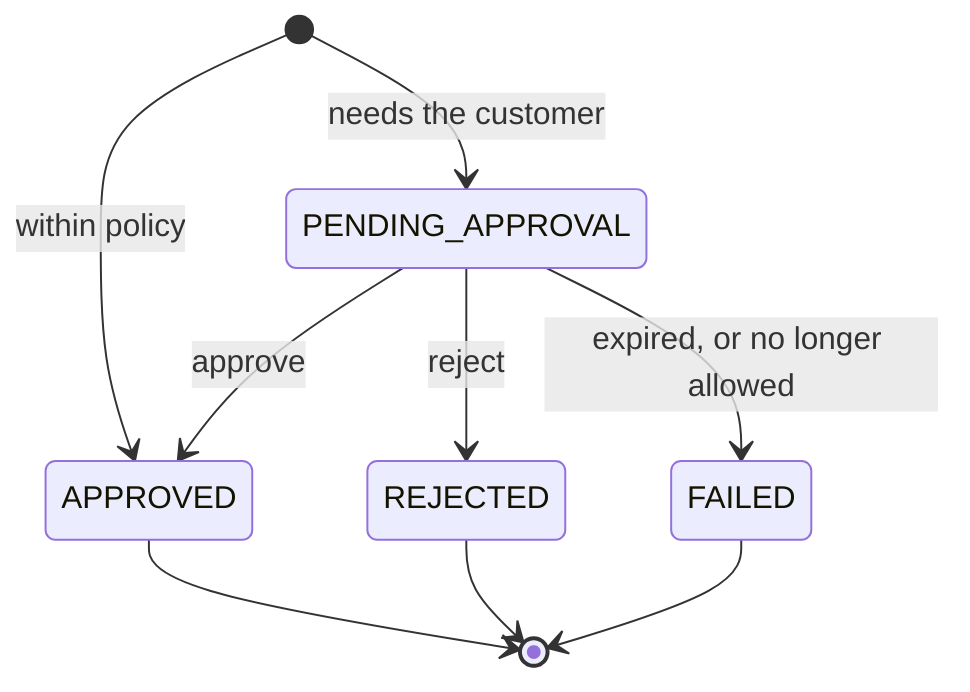

<Note>
The Agents API is experimental and in limited availability. To request access, [book a demo](https://www.lightspark.com/contact) or reach out to your Lightspark contact.
</Note>

Every money movement an agent asks for is an `AgentAction`. Grid creates it, decides whether it can run on its own, and when it can't, holds it in `PENDING_APPROVAL` until your platform sends the customer's decision. Grid owns the approval state and the execution; your product owns how the request reaches the customer.

## Approval lifecycle

1. The agent submits a request: executing a quote, issuing a purchase card, using a stored card, sending a claimable payout, starting a payout run, or proposing a settlement rule.
2. Grid checks the agent's policy and spending pool. A request they forbid is refused outright. One they allow either runs at once (`APPROVED`) or waits (`PENDING_APPROVAL`).
3. For a waiting request, Grid sends `AGENT_ACTION.PENDING_APPROVAL` to your [webhook endpoint](/agent-accounts/platform-tools/webhooks) with the full `AgentAction`, so you can render the request without a second API call.
4. You notify the customer and show the request in a surface they trust.
5. Your backend calls `POST /agents/{agentId}/actions/{actionId}/approve` or `.../reject` with platform credentials.
6. Grid re-checks the request against the current policy and executes it. The action ends `APPROVED`, `REJECTED` or `FAILED`.
7. The agent learns the outcome by polling `GET /agents/me/actions/{actionId}`.



## Action types

| `type` | The agent asked to | Shown in | Approving it |
|---|---|---|---|
| `EXECUTE_QUOTE` | Send money on a quote | `quote` | Executes the quote |
| `ISSUE_PURCHASE_CARD` | Get a purchase card, or raise an unused one's amount | `purchaseCard` | Issues the card (or raises it) and sets `cardId` |
| `USE_STORED_CARD` | Use one of the customer's stored cards | `storedCardUse` | Lets the agent collect one single-use link to the card's details |
| `CLAIMABLE_PAYOUT` | Pay a person by phone number or email | `claimablePayout` | Makes the payout claimable (`AWAITING_CLAIM`) |
| `PAYOUT_RUN` | Pay up to 50 people at once | `payoutRun` | Starts the run; the approval covers every row |
| `CREATE_SETTLEMENT_RULE` | Split future incoming payments by a standing rule | `settlementRule` | Makes the rule `ACTIVE` |
| `UPDATE_SETTLEMENT_RULE` | Change a rule's match, shares or limits | `settlementRule` (as changed) | Applies the change |

Approving a settlement rule does not approve its payments in advance: each share is still checked against the agent's policy when it is sent.

## What to show the customer

The approval UI should answer, at a glance:

- Which agent is asking, and for what (`type`)?
- How much, in which currencies, and from which account?
- To whom or where? For a purchase card or stored card use, the merchant and the agent's description of the purchase.
- Why does it need approval, and until when (`expiresAt`)?

Values the agent supplies, such as a purchase card's `description` or a stored card use's `merchant` and `purpose`, are not verified by Grid. Present them as the agent's words.

### A pending send

```json
{
  "id": "AgentAction:019542f5-b3e7-1d02-0000-000000000099",
  "agentId": "Agent:019542f5-b3e7-1d02-0000-000000000042",
  "customerId": "Customer:019542f5-b3e7-1d02-0000-000000000010",
  "platformCustomerId": "user-a1b2c3",
  "status": "PENDING_APPROVAL",
  "type": "EXECUTE_QUOTE",
  "quote": {
    "id": "Quote:019542f5-b3e7-1d02-0000-000000000006",
    "status": "PENDING",
    "source": { "sourceType": "ACCOUNT", "accountId": "InternalAccount:019542f5-b3e7-1d02-0000-000000000002" },
    "destination": { "destinationType": "ACCOUNT", "accountId": "ExternalAccount:e85dcbd6-dced-4ec4-b756-3c3a9ea3d965" },
    "destinationSparkAddress": "spark1pgssyuuuhnrrdjswal5c3s3rafw9w3y5dd4cjy3duxlf7hjzkp0rqx6dj6mrhu",
    "sendingCurrency": { "code": "USDB", "name": "USDB", "symbol": "$", "decimals": 2 },
    "receivingCurrency": { "code": "USDB", "name": "USDB", "symbol": "$", "decimals": 2 },
    "totalSendingAmount": 5000,
    "totalReceivingAmount": 5000,
    "expiresAt": "2025-10-03T15:00:30Z"
  },
  "expiresAt": "2025-10-03T15:00:30Z",
  "createdAt": "2025-10-03T15:00:00Z",
  "updatedAt": "2025-10-03T15:00:00Z"
}
```

### A pending purchase card

```json
{
  "id": "AgentAction:019542f5-b3e7-1d02-0000-000000000098",
  "agentId": "Agent:019542f5-b3e7-1d02-0000-000000000042",
  "customerId": "Customer:019542f5-b3e7-1d02-0000-000000000010",
  "platformCustomerId": "user-a1b2c3",
  "status": "PENDING_APPROVAL",
  "type": "ISSUE_PURCHASE_CARD",
  "purchaseCard": {
    "amount": 12000,
    "spendLimit": 13000,
    "currency": "USD",
    "description": "Concert tickets from example-tickets.com",
    "fundingSource": "InternalAccount:019542f5-b3e7-1d02-0000-000000000002"
  },
  "expiresAt": "2026-10-26T15:15:00Z",
  "createdAt": "2026-10-26T15:00:00Z",
  "updatedAt": "2026-10-26T15:00:00Z"
}
```

## Approving and rejecting

Both calls use your platform credentials and return the updated `AgentAction`. The `agentId` and `actionId` are in the webhook payload.

```bash
# Approve
curl -X POST "$GRID_BASE_URL/agents/Agent:019542f5-b3e7-1d02-0000-000000000042/actions/AgentAction:019542f5-b3e7-1d02-0000-000000000099/approve" \
  -u "$GRID_CLIENT_ID:$GRID_CLIENT_SECRET"

# Reject, with an optional reason stored on the action
curl -X POST "$GRID_BASE_URL/agents/Agent:019542f5-b3e7-1d02-0000-000000000042/actions/AgentAction:019542f5-b3e7-1d02-0000-000000000099/reject" \
  -u "$GRID_CLIENT_ID:$GRID_CLIENT_SECRET" \
  -H "Content-Type: application/json" \
  -d '{ "reason": "Customer declined in app" }'
```

Only a `PENDING_APPROVAL` action can be decided; deciding one that is already decided returns `409`. Treat a `409` on a retry as "already handled" and read the action's current state.

<Warning>
Grid cannot see the customer when you call approve. Confirm the decision with them in your app first, with a fresh step-up such as a passkey or an emailed code, especially for stored card uses and anything above your own risk thresholds.
</Warning>

### Approving a stored card use

`USE_STORED_CARD` is the only type that takes a body on approve:

| Field | Use |
|---|---|
| `storedCardCvc` | The card's security code, encrypted by Evervault's Card component (`ev:...`). Required when `storedCardUse.needsCvc` is `true`; approving such a use without it is refused with `400`. Grid holds it only until the agent opens its link or the link expires. |
| `autoApproveMerchant` | Also let this agent use this card at this merchant again, up to this use's amount, without asking. A later use that needs the security code still asks. |

Sending either field on any other action type is refused with `400`. See [Cards](/agent-accounts/cards#stored-cards).

## When approval doesn't execute

Grid checks the action again when you approve it, against the account and policy as they are then. Between the request and the decision the agent may have been paused, the limits lowered, the daily spend used up, or the quote expired. In those cases the action ends `FAILED` with a `failureReason`:

| `failureReason` | Meaning |
|---|---|
| `QUOTE_EXPIRED` | The quote expired before execution, or Grid could no longer quote the send |
| `POLICY_DENIED` | The agent's policy no longer allows the action |
| `AGENT_INACTIVE` | The agent was paused or deleted, or, for a stored card use, the card was removed or the agent lost access |
| `EXECUTION_FAILED` | Grid could not execute the approved action, for example the card issuer did not issue a purchase card |
| `ADDRESS_REFUSED` | Grid refused the send's destination before signing, for example a Spark address removed from the customer's saved addresses |
| `APPROVAL_EXPIRED` | The action was not approved before its `expiresAt` |
| `DELETED_BY_AGENT` | The agent deleted the settlement rule the action would create or change |
| `AGENT_CANCELLED` | The agent cancelled the payout run the action would start |

`PRICE_MOVED` is reserved and legacy; quotes to stablecoin addresses pay at a locked rate and no longer fail with it.

### Expiry

`expiresAt` on the action is when it stops waiting:

- An `EXECUTE_QUOTE` action without `priceTolerance` expires with its quote. Quotes are short-lived, so notify the customer immediately.
- An `EXECUTE_QUOTE` action with `priceTolerance`, and every `ISSUE_PURCHASE_CARD`, `USE_STORED_CARD`, `CLAIMABLE_PAYOUT`, `PAYOUT_RUN`, `CREATE_SETTLEMENT_RULE` and `UPDATE_SETTLEMENT_RULE` action, waits until the end of its own approval window. A payout run's window is 24 hours and a settlement rule's seven days.

### Re-quoted sends

Where Grid has enabled it for your platform, an `EXECUTE_QUOTE` action carries `priceTolerance` and keeps waiting after its quote expires:

- Approved while the quote is live, it sends that quote as shown.
- Approved after the quote expired, Grid quotes the send again and runs every check against the new quote. If the new price is no worse for the customer than `priceTolerance` allows (the larger of `basisPoints` of the amount shown and `minimumAmount`), Grid sends it and the action is `APPROVED` with the new `quote`.
- If the price moved against the customer by more, nothing is sent. Approve returns `200` with the action still `PENDING_APPROVAL`, the new `quote`, and `previousQuote` set to the quote the customer saw. Show both and ask again; approving again repeats the check. A better price never asks again.

Tell the customer about the tolerance when you ask them, using the numbers in `priceTolerance`.

## History and audit

| You want | Call |
|---|---|
| Actions awaiting or requiring approval, across agents | `GET /agents/approvals`, filtered by `agentId`, `customerId`, `startDate` and `endDate`; `limit` (default 20, max 100), `cursor`, `sortOrder` |
| One agent's own actions (agent token) | `GET /agents/me/actions`, filtered by `status` |
| Money that moved | `GET /agents/me/transactions` (agent token), or your usual transaction endpoints and webhooks. An approved action carries its `transaction` once execution begins. |

`rejectionReason` is set only on `REJECTED` actions and `failureReason` only on `FAILED` ones, so the customer can always tell a decline from a failure.

Grid also records an audit entry with the agent as the actor each time an agent reveals a purchase card or a stored card, or adds a card to a digital wallet.

## Pause, revoke and delete

Customers need immediate control over delegated access. Offer at least:

- **Pause:** `PATCH /agents/{agentId}` with `isPaused: true`. A paused agent cannot initiate any action; its pending actions fail with `AGENT_INACTIVE` if approved. Resume with `isPaused: false`.
- **Revoke signing:** `DELETE /auth/delegated-keys/{id}` stops Grid signing the agent's sends from that wallet.
- **Delete:** `DELETE /agents/{agentId}`. Connected agent software loses access immediately.

## Integration guidance

- Subscribe to `AGENT_ACTION.PENDING_APPROVAL` and send the customer a push notification at once.
- Build an in-app approval queue from `GET /agents/approvals` for customers who miss the notification.
- Make approve and reject safe to retry: a duplicate tap should land on "already handled", not an error.
- Show `REJECTED` and `FAILED` differently. They mean different things to the customer.
- Keep agent activity next to the account and transaction views the customer already uses.
