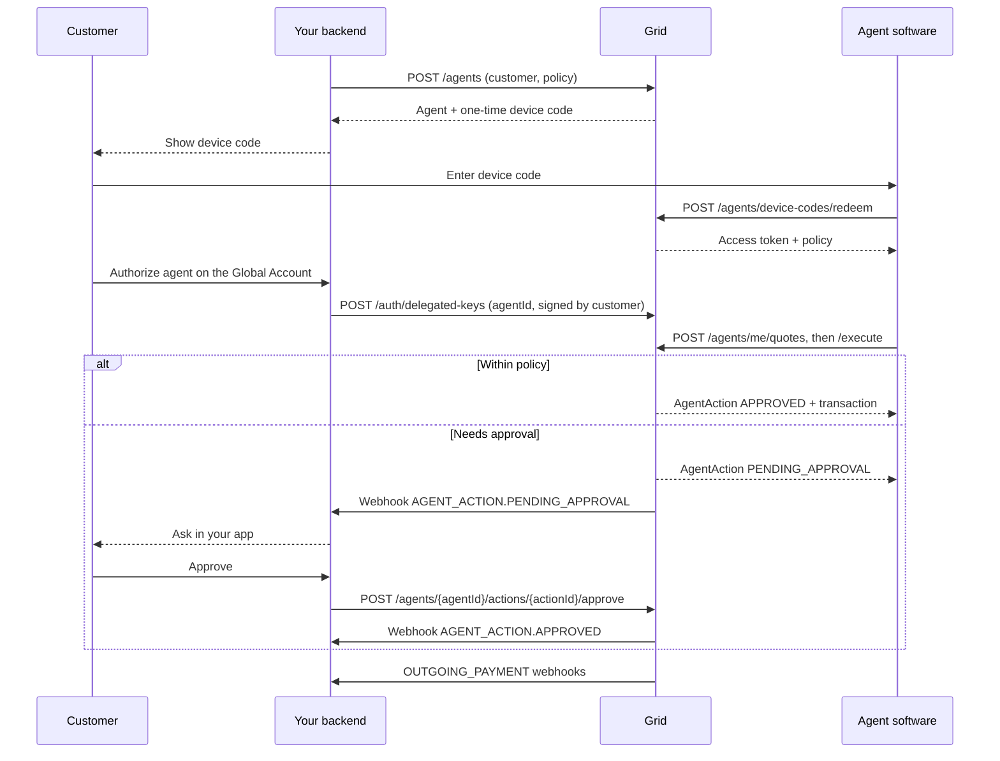

<Note>
The Agents API must be enabled for your platform; until it is, agent endpoints answer `403`. To enable it, [book a demo](https://www.lightspark.com/contact) or reach out to your Lightspark contact.
</Note>

This guide is for Grid platforms adding agents for their own customers. If you build an AI app and want your users to get a Lightspark account inside it, see [AI app connector](/agent-accounts/ai-app-connector) instead.

This page walks the happy path from a verified customer to an agent that pays on its own under a limit and asks the customer above it. Each step links to the page that covers it in depth.

## Prerequisites

- The Agents API is enabled for your platform. Every agent endpoint answers `403` until it is.
- The customer exists and has completed KYC (or KYB for a business). In sandbox, customers are KYC-approved on creation.
- The customer has a [Global Account](/global-accounts) (an `EMBEDDED_WALLET` internal account), with a verified authentication credential you can use to sign. See [Implementation overview](/global-accounts/implementation-overview) for Global Accounts.

## Two kinds of credentials

| Caller | Authenticates with | Calls |
|---|---|---|
| **Your backend** | Your platform API token, HTTP Basic auth | `POST /agents`, `PATCH /agents/{agentId}/policy`, `POST /agents/{agentId}/actions/{actionId}/approve`, and every other platform endpoint |
| **The agent software** | The agent's access token, `Authorization: Bearer <accessToken>` | Endpoints under `/agents/me/...`, always scoped to the agent's customer and policy |

The agent never sees your platform credentials, and your backend never needs the agent's token.

## Sequence



## Walkthrough

<Steps>
<Step title="Create the agent">
  Your backend creates the agent for a customer with a policy. Send an `Idempotency-Key` so a retry returns the same agent instead of creating a second one.

  ```bash
  curl -X POST "$GRID_BASE_URL/agents" \
    -u "$GRID_CLIENT_ID:$GRID_CLIENT_SECRET" \
    -H "Content-Type: application/json" \
    -H "Idempotency-Key: 550e8400-e29b-41d4-a716-446655440000" \
    -d '{
      "name": "Shopping assistant",
      "customerId": "Customer:019542f5-b3e7-1d02-0000-000000000001",
      "policy": {
        "permissions": ["VIEW_TRANSACTIONS", "CREATE_QUOTES", "EXECUTE_QUOTES", "RECEIVE_FUNDS"],
        "defaultExecutionMode": "AUTO",
        "spendingLimits": {
          "currency": "USD",
          "perTransactionLimit": 50000,
          "dailyLimit": 100000,
          "dailyTransactionLimit": 10
        },
        "approvalThresholds": { "currency": "USD", "amount": 2500 }
      }
    }'
  ```

  The `201` response carries the `agent` and a `deviceCode`. See [Creating agents](/agent-accounts/creating-agents).
</Step>

<Step title="Connect the agent software">
  Show the customer the `deviceCode.code`. The agent software redeems it, without platform credentials, and receives its access token once:

  ```bash
  curl -X POST "$GRID_BASE_URL/agents/device-codes/redeem" \
    -H "Content-Type: application/json" \
    -d '{ "code": "jqzJR3AgI9OAwb_enypARw" }'
  ```

  Poll `POST /agents/device-codes/status` from your backend to see when it is `REDEEMED`. The agent's `isConnected` becomes `true`.
</Step>

<Step title="Let the agent sign from the Global Account">
  The customer authorizes a delegated key for this agent and their Embedded Wallet with `POST /auth/delegated-keys` and `agentId`. Creation is a three-leg signed-retry flow signed with the customer's session key, so it always involves the customer. Without an `ACTIVE` key, the agent's quote executions from the wallet are refused. See [Creating agents](/agent-accounts/creating-agents#delegate-signing-on-the-global-account).
</Step>

<Step title="Fund the account">
  Fund the Global Account the way you fund any internal account, or let the agent create a deposit target with `POST /agents/me/deposits` (Lightning invoice or stablecoin address). In sandbox, use `POST /sandbox/internal-accounts/{accountId}/fund`. See [Funding](/agent-accounts/funding).
</Step>

<Step title="The agent pays">
  The agent quotes with `POST /agents/me/quotes` and executes with `POST /agents/me/quotes/{quoteId}/execute`. Execution returns an `AgentAction`: `APPROVED` with a `transaction` when the policy allows it, or `PENDING_APPROVAL` when the customer must decide. See [Payments](/agent-accounts/payments).
</Step>

<Step title="Handle approvals">
  Subscribe to `AGENT_ACTION.PENDING_APPROVAL`, show the customer the request, and call `POST /agents/{agentId}/actions/{actionId}/approve` or `.../reject` with their decision. The agent learns the outcome by polling `GET /agents/me/actions/{actionId}`. See [Approvals & audit](/agent-accounts/approvals-and-audit).
</Step>

<Step title="Give the customer control">
  Let the customer change the policy (`PATCH /agents/{agentId}/policy`), pause the agent (`PATCH /agents/{agentId}` with `isPaused: true`), or delete it (`DELETE /agents/{agentId}`). Paused agents cannot initiate any action; deleted agents lose access immediately.
</Step>
</Steps>

## Where to next

<CardGroup cols={2}>
  <Card title="Policies & permissions" href="/agent-accounts/policies-and-permissions" icon="shield-check">
    Every policy field, and how Grid decides between executing, asking and refusing.
  </Card>
  <Card title="Cards" href="/agent-accounts/cards" icon="credit-card">
    Purchase cards, recurring cards, and the customer's stored cards.
  </Card>
  <Card title="Spending limits" href="/agent-accounts/spending-limits" icon="wallet">
    Share one budget across a customer's agents with spending pools.
  </Card>
  <Card title="Sandbox testing" href="/agent-accounts/platform-tools/sandbox-testing" icon="hammer">
    Run the whole flow without moving real money.
  </Card>
</CardGroup>
