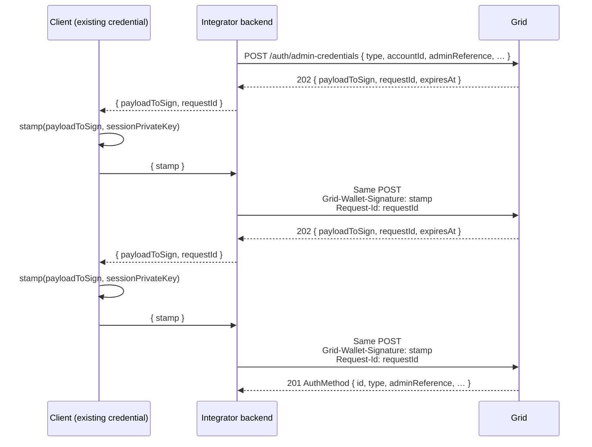

A `BUSINESS` customer's Global Account can have more than one administrator. Each additional administrator holds their own `EMAIL_OTP`, `PASSKEY`, or `EVM_WALLET` credential, tagged with an `adminReference` your platform chooses, and signs for the wallet with it as the owner does.

Each administrator credential is a wallet user of its own, apart from the owner's, so removing one administrator leaves every other credential standing. The wallet stays self-custodial: Grid never adds an administrator on its own. Every add and every removal is approved by a signature from an existing verified credential on the account, either the owner's or another administrator's.

Before you add an administrator:

- The customer must be a `BUSINESS` customer. For any other customer, `POST /auth/admin-credentials` returns `400 INVALID_INPUT`.
- The Global Account's wallet must be created and the account's `status` must be `ACTIVE`. While the account has no wallet or is still `PENDING`, `POST /auth/admin-credentials` returns `409 WALLET_NOT_PROVISIONED`.
- Someone already on the account, the owner or an existing administrator, needs an active session to approve the add. See <a href="authentication">Authentication</a>.

## The admin reference

`adminReference` is your platform's opaque reference for the administrator, such as a member id, from 1 to 255 characters. Grid stores it as given and returns it on the administrator's credentials and sessions. The owner's credentials and sessions carry no `adminReference`.

Grid uses it to remove an administrator: revoking an `adminReference` revokes every credential that carries it. An administrator added with another administrator's approval gets their own `adminReference` and is removed separately.

## Add an administrator

Adding an administrator takes two signed steps. The first call returns a `payloadToSign` that creates the administrator's wallet user. Its signed retry returns a second `payloadToSign` that grants that user the authority to sign for the wallet. The second signed retry returns the new credential.



Both signatures come from the session of an existing verified credential on the account. The new administrator takes no part until they sign in.

<Steps>
  <Step title="First call — receive the first challenge">
    The request body depends on the administrator's credential type.

    <CodeGroup>
    ```bash Email OTP
    curl -X POST "$GRID_BASE_URL/auth/admin-credentials" \
      -u "$GRID_CLIENT_ID:$GRID_CLIENT_SECRET" \
      -H "Content-Type: application/json" \
      -d '{
        "type": "EMAIL_OTP",
        "accountId": "InternalAccount:019542f5-b3e7-1d02-0000-000000000002",
        "adminReference": "member_8f2c1a",
        "email": "admin@example.com"
      }'
    ```

    ```bash Passkey
    # CHALLENGE is the WebAuthn registration challenge your backend issued.
    # The other values come from the administrator's navigator.credentials.create() result.
    curl -X POST "$GRID_BASE_URL/auth/admin-credentials" \
      -u "$GRID_CLIENT_ID:$GRID_CLIENT_SECRET" \
      -H "Content-Type: application/json" \
      -d '{
        "type": "PASSKEY",
        "accountId": "InternalAccount:019542f5-b3e7-1d02-0000-000000000002",
        "adminReference": "member_8f2c1a",
        "nickname": "Admin MacBook",
        "challenge": "'"$CHALLENGE"'",
        "attestation": {
          "credentialId": "'"$CREDENTIAL_ID"'",
          "clientDataJson": "'"$CLIENT_DATA_JSON"'",
          "attestationObject": "'"$ATTESTATION_OBJECT"'",
          "transports": ["internal", "hybrid"]
        }
      }'
    ```

    ```bash EVM wallet
    curl -X POST "$GRID_BASE_URL/auth/admin-credentials" \
      -u "$GRID_CLIENT_ID:$GRID_CLIENT_SECRET" \
      -H "Content-Type: application/json" \
      -d '{
        "type": "EVM_WALLET",
        "accountId": "InternalAccount:019542f5-b3e7-1d02-0000-000000000002",
        "adminReference": "member_8f2c1a",
        "publicKey": "0x024e3b81af9c2234cad09d679ce6035ed1392347ce64ce405f5dcd36228a25de6e"
      }'
    ```
    </CodeGroup>

    - **`EMAIL_OTP`**: `email` is the administrator's own address, which receives their one-time codes. It must differ from every other email credential on the account.
    - **`PASSKEY`**: the same `nickname`, `challenge`, and `attestation` fields as a passkey registration. The administrator's device creates the passkey, and its registration result fills `$CREDENTIAL_ID`, `$CLIENT_DATA_JSON`, and `$ATTESTATION_OBJECT` as base64url, as in the guide's <a href="authentication#passkey-registration">passkey registration sample</a>. Grid accepts only ES256 (-7) and RS256 (-257) passkeys.
    - **`EVM_WALLET`**: `publicKey` is the secp256k1 public key of the administrator's wallet, as `0x`-prefixed hex: compressed (33 bytes, starting `02` or `03`) or uncompressed (65 bytes, starting `04`). It must be the key of a wallet with a single private key, not a smart-contract account. Grid derives the wallet's address and returns it as the credential's `identifier`, which is also its default `nickname`. The new administrator's wallet signs nothing to be added: Grid issues no ownership challenge, and the wallet first signs when the administrator signs in.

    `EMAIL_OTP` and `EVM_WALLET` also take an optional `nickname`, such as the administrator's name. To rename an administrator's credential later, use `PATCH /auth/credentials/{id}`, as for the owner's. See <a href="authentication#rename-a-credential">Rename a credential</a>.

    **Response (202):** a `payloadToSign`, `requestId`, and `expiresAt`.
  </Step>
  <Step title="First signed retry — receive the second challenge">
    The client stamps `payloadToSign` with the session signing key of an existing verified credential. Retry the identical request with `Grid-Wallet-Signature` and `Request-Id`.

    **Response (202):** a second `payloadToSign` and a new `requestId`.
  </Step>
  <Step title="Second signed retry — the administrator is added">
    Stamp the second `payloadToSign` the same way, then retry the identical request again with the new stamp and the second `requestId`.

    **Response (201):**

    ```json
    {
      "id": "AuthMethod:019542f5-b3e7-1d02-0000-000000000005",
      "accountId": "InternalAccount:019542f5-b3e7-1d02-0000-000000000002",
      "type": "EMAIL_OTP",
      "nickname": "admin@example.com",
      "identifier": "admin@example.com",
      "adminReference": "member_8f2c1a",
      "createdAt": "2026-04-08T15:30:01Z",
      "updatedAt": "2026-04-08T15:30:01Z"
    }
    ```
  </Step>
</Steps>

To give an administrator another credential, call `POST /auth/admin-credentials` again with the same `adminReference`.

### Administrator sign-in

The administrator signs in with `POST /auth/credentials/{id}/challenge` and `POST /auth/credentials/{id}/verify`, as the owner signs in with a credential of the same type. An `EMAIL_OTP` administrator's codes go to their own email address. An `EVM_WALLET` administrator's wallet signs the challenge's `payloadToSign` and sends it to `/verify` as `signature`. See <a href="authentication#evm-wallet-sign-in">EVM wallet sign-in</a>.

### Errors

| Status | Code | When |
|---|---|---|
| `400` | `INVALID_INPUT` | The customer is not a `BUSINESS` customer, the email is already on the account, the passkey's key algorithm is not ES256 or RS256, or `publicKey` is not a point on secp256k1. For `publicKey`, `details.errors[]` has an entry whose `field` is `publicKey`. |
| `400` | `WALLET_CREDENTIAL_ALREADY_EXISTS` | The EVM wallet's key is already on the account, as the owner's credential or another administrator's. |
| `401` | `UNAUTHORIZED` | A signature does not verify, or `Request-Id` does not match an open challenge. |
| `409` | `WALLET_NOT_PROVISIONED` | The account has no wallet yet, or its `status` is still `PENDING`. Retry once it is `ACTIVE`. |

Grid returns `404` when the internal account does not exist.

## List administrators

Administrators' credentials appear in `GET /auth/credentials` alongside the owner's, and their sessions appear in `GET /auth/sessions`. An administrator's entries carry their `adminReference`; the owner's carry none.

```bash
curl -X GET "$GRID_BASE_URL/auth/credentials?accountId=InternalAccount:019542f5-b3e7-1d02-0000-000000000002" \
  -u "$GRID_CLIENT_ID:$GRID_CLIENT_SECRET"
```

**Response (200):**

```json
{
  "data": [
    {
      "id": "AuthMethod:019542f5-b3e7-1d02-0000-000000000004",
      "accountId": "InternalAccount:019542f5-b3e7-1d02-0000-000000000002",
      "type": "EMAIL_OTP",
      "nickname": "owner@example.com",
      "identifier": "owner@example.com",
      "createdAt": "2026-04-08T15:00:00Z",
      "updatedAt": "2026-04-08T15:00:00Z"
    },
    {
      "id": "AuthMethod:019542f5-b3e7-1d02-0000-000000000005",
      "accountId": "InternalAccount:019542f5-b3e7-1d02-0000-000000000002",
      "type": "EMAIL_OTP",
      "nickname": "admin@example.com",
      "identifier": "admin@example.com",
      "adminReference": "member_8f2c1a",
      "createdAt": "2026-04-08T15:30:01Z",
      "updatedAt": "2026-04-08T15:30:01Z"
    }
  ]
}
```

## What an administrator's session can do

An administrator's session signs for the wallet as the owner's does, with these differences:

- **It cannot add credentials with `POST /auth/credentials`.** Grid refuses an administrator's signature there with `403 FORBIDDEN`. A credential added there carries no `adminReference`, so it would outlive the administrator's removal. Administrators add their own credentials with `POST /auth/admin-credentials`.
- **It can approve adding or removing another administrator.** That administrator gets their own `adminReference`.
- **Its credentials are removed only as a whole administrator.** `DELETE /auth/credentials/{id}` refuses an administrator's credential with `400 INVALID_INPUT`. Use `DELETE /auth/admin-credentials/{adminReference}` instead.

Administrators' credentials are not counted toward the owner's limits. They don't use up the owner's one `EMAIL_OTP` credential, and they don't count as the owner's remaining credential, so the owner still can't revoke their own last credential while administrators exist.

## Remove an administrator

`DELETE /auth/admin-credentials/{adminReference}` revokes every credential carrying that `adminReference` on the account, along with their sessions. It is approved like the add: the first call returns `202`, and the session of an existing verified credential on the account stamps it.

<Steps>
  <Step title="First call — receive the challenge">
    ```bash
    curl -X DELETE "$GRID_BASE_URL/auth/admin-credentials/member_8f2c1a?accountId=InternalAccount:019542f5-b3e7-1d02-0000-000000000002" \
      -u "$GRID_CLIENT_ID:$GRID_CLIENT_SECRET"
    ```

    **Response (202):** a `payloadToSign`, `requestId`, and `expiresAt`.
  </Step>
  <Step title="Signed retry — the administrator is removed">
    ```bash
    curl -X DELETE "$GRID_BASE_URL/auth/admin-credentials/member_8f2c1a?accountId=InternalAccount:019542f5-b3e7-1d02-0000-000000000002" \
      -u "$GRID_CLIENT_ID:$GRID_CLIENT_SECRET" \
      -H "Grid-Wallet-Signature: eyJwdWJsaWNLZXkiOiIwMmExYjIuLi4iLCJzY2hlbWUiOiJTSUdOQVRVUkVfU0NIRU1FX1RLX0FQSV9QMjU2Iiwic2lnbmF0dXJlIjoiMzA0NTAyMjEwMC4uLiJ9" \
      -H "Request-Id: Request:2b1e5a08-9c44-4e91-ae7f-6d0b3f8c1e22"
    ```

    **Response:** `204 No Content`.
  </Step>
</Steps>

Grid refuses the removal with `400 INVALID_INPUT` when it would leave the account with no active credential. It returns `404` when the account has no administrator with that `adminReference`, and `409 WALLET_NOT_PROVISIONED` while the account has no wallet or is still `PENDING`, as the add does.
